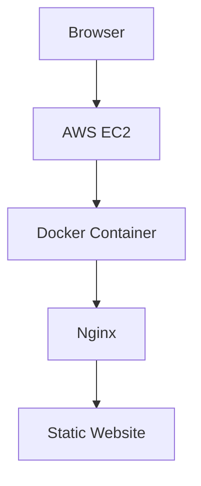
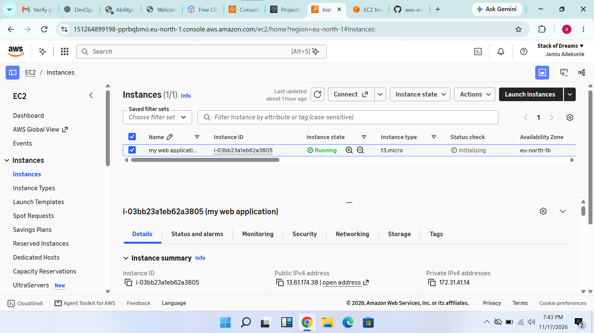

# Dockerized Static Website Deployment on AWS EC2

## Project Overview

This project demonstrates how to containerize and deploy a static website using Docker and Nginx on an AWS EC2 Ubuntu server.

The website runs inside a Docker container, making deployment more portable and consistent.

## Technologies Used

- AWS EC2
- Ubuntu 24.04 LTS
- Docker
- Dockerfile
- Nginx
- HTML
- Git and GitHub

## Project Architecture



## Implementation Steps

1. Launched an Ubuntu EC2 instance on AWS.
2. Installed and configured Docker Engine.
3. Created a static website using HTML.
4. Wrote a Dockerfile using the Nginx Alpine image.
5. Built a custom Docker image.
6. Launched a Docker container.
7. Mapped EC2 port 8080 to container port 80.
8. Configured AWS security group inbound access.
9. Tested the deployed website through a web browser.

## Docker Commands

Build the image:

```bash
sudo docker build -t abilitycloud-docker-website .
```

Run the container:

```bash
sudo docker run -d --name abilitycloud-website-container -p 8080:80 abilitycloud-docker-website
```

Check running containers:

```bash
sudo docker ps
```

View Docker images:

```bash
sudo docker images
```

## Live Deployment

The website was deployed on AWS EC2 and accessed through port 8080.

## Key Learning Outcomes

- Docker image creation and container management.
- Containerizing static websites with Nginx.
- Port mapping and network configuration.
- Deploying containerized applications on AWS EC2.
- Managing application deployment using Linux commands.

## Author

**Adekunle Jamiu Oyetayo**

GitHub: https://github.com/Abilitycloud

LinkedIn: https://www.linkedin.com/in/adekunle-jamiu-oyetayo

## Project Screenshots

### 1. AWS EC2 Instance


### 2. Docker Service Running


### 3. Docker Container Running


### 4. Live Dockerized Website

